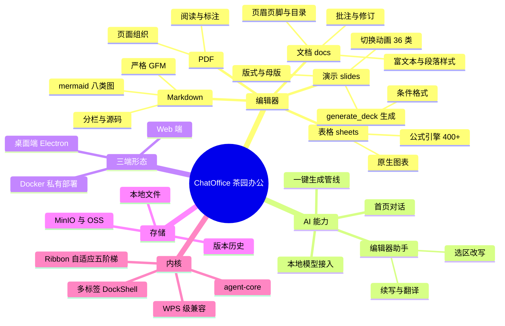

# ChatOffice 功能地图

> 用产品原生支持的 mermaid `mindmap` 绘制——本文在 ChatOffice Markdown 编辑器中打开即为一张可交互的思维导图。

## 阅读指引

- 根节点为产品本体，五个一级分支对应产品五大支柱。
- 「编辑器」分支最重，五款编辑器各自携带标志性能力。
- 「AI 能力」与「内核」分支描述生产效率的来源：对话即生产、自动化有底座。
